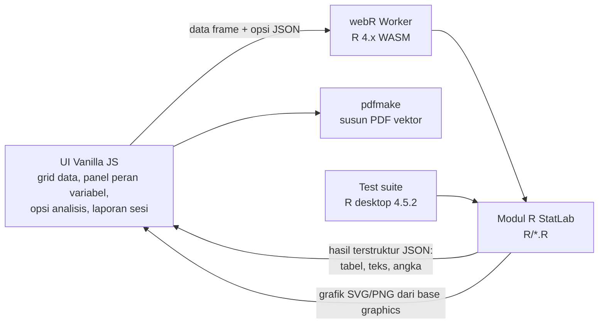

# StatLab — Dokumen Desain

**Tanggal:** 2026-10-28 · **Status:** Draf, menunggu persetujuan
**Lokasi proyek:** `C:\Users\Ariel's Device\.gemini\antigravity\scratch\statlab`
**Sumber fitur:** modul Statistik & Chart Maker Aqua Tools (`scratch\aqua-tools\pages\statistics.html`, `chart-maker.html`, `js\statistics\*.js`, `js\charts\chart-maker.js`)

---

## 1. Maksud & Alasan

Aqua Tools saat ini menghitung statistik dengan JavaScript buatan sendiri (tabel Q Tukey hasil interpolasi, Shapiro-Wilk port manual, dll.). Pemilik ingin sistem statistik sendiri — **StatLab** — yang:

- seluruh perhitungannya memakai **R** (base R + paket bawaan R), agar hasilnya setara software statistik rujukan dan dapat dipertanggungjawabkan di skripsi/jurnal;
- **selalu menguji normalitas** (dan homogenitas bila relevan) sebelum analisis;
- menambah analisis **HCA, PCA, Clustering (k-means), PCoA, MANOVA, Kaplan-Meier, Repeated Measures ANOVA**;
- memberi **post hoc** untuk setiap analisis yang memungkinkan;
- menutup laporan dengan **kesimpulan tertulis**;
- dapat **di-install di browser** (PWA), di-hosting sementara di **GitHub Pages**, lalu dipindah ke server sendiri;
- nantinya **digabung ke Aqua Tools** sebagai satu kesatuan (saat ini berdiri sendiri).

Pengguna: peneliti/mahasiswa perikanan & akuakultur Indonesia.

## 2. Tujuan, Bukan-Tujuan, Anti-Tujuan

**Tujuan**
- Semua angka statistik dihasilkan oleh kode R yang berjalan di webR.
- Laporan sesi kumulatif → PDF vektor yang bisa diunduh, dengan kesimpulan bilingual (ID/EN).
- Bekerja offline setelah pemuatan pertama.

**Bukan-tujuan**
- Tidak membawa modul non-statistik Aqua Tools (hematologi, plankton, qPCR, dll.).
- Tidak memakai paket CRAN di luar paket bawaan/recommended R.
- Tidak membuat akun pengguna / penyimpanan cloud.
- Tidak memakai AI untuk menulis kesimpulan (berbasis aturan/template).

**Anti-tujuan (gagal walau “jalan”)**
- Ada angka statistik yang dihitung oleh JavaScript.
- Analisis berjalan tanpa uji normalitas dilaporkan lebih dulu.
- Hasil berbeda dari R desktop (versi R yang setara dengan webR) di luar toleransi §9 untuk data yang sama.
- Data pencilan dibuang diam-diam.
- Struktur kode yang menyulitkan penggabungan ke Aqua Tools.

## 3. Batasan

- **Mesin hitung:** R di **webR** (R yang dikompilasi ke WebAssembly), di dalam browser.
- **Paket R yang diizinkan:** base, stats, graphics, grDevices, utils, tools, methods **+ paket recommended**: `survival`, `cluster`, `MASS`. Setiap pemakaian fungsi paket recommended (dan `TukeyHSD`) **wajib divalidasi** dengan implementasi manual (lihat §9).
- **JavaScript hanya untuk:** UI, grid data, parsing CSV ke data frame R, menampilkan hasil, menyusun tata letak PDF. **Tidak boleh menghitung statistik.**
- **Hosting:** statis (GitHub Pages). Tidak ada server backend. GitHub Pages tidak mengirim header COOP/COEP → webR berjalan dengan kanal `PostMessage` (bukan SharedArrayBuffer); fitur yang butuh input interaktif blocking tidak dipakai.
- **Ukuran:** pemuatan pertama ±20–40 MB (webR + paket), lalu di-cache service worker. Komputasi berat 2–5× lebih lambat dari R desktop.
- **R desktop 4.5.2** terinstal di `C:\Program Files\R\R-4.5.2` (tidak ada di PATH) — dipakai untuk test suite.

## 4. Pendekatan (dipilih: A)

| | Pendekatan | Trade-off |
|---|---|---|
| **A ✅** | **Vanilla JS + ES modules (tanpa framework/build) + folder modul R dual-use** (sama persis di webR & R desktop) | Paling mudah digabung ke Aqua Tools (juga vanilla PWA); deploy cukup push. UI besar perlu disiplin struktur. |
| B | Vite + Svelte/React | UI lebih terkelola, tapi butuh build step & jembatan saat digabung ke Aqua Tools. |
| C | Shinylive | UI ditulis di R, tapi Shiny bukan base R, tampilan custom sulit, bundel berat. |

Dipilih **A** oleh pemilik karena target akhir menyatu dengan Aqua Tools.

Keputusan arsitektur yang sempat berubah: awalnya server lokal R (`tools:::httpd`) + PDF via Edge headless; **diganti** ke webR + PDF via pdfmake setelah diketahui target hosting GitHub Pages / install di browser.

## 5. Arsitektur

- **Kontrak R→JS:** setiap fungsi analisis R mengembalikan list terstruktur (diserialisasi JSON) berisi: `meta` (nama analisis, variabel, n, data dibuang), `assumptions` (normalitas, homogenitas, sferisitas, dll.), `main` (tabel uji utama), `posthoc`, `effect_size`, `tables_apa`, `tables_full`, `plots` (SVG/PNG), `interpretation` (`id`, `en`), `warnings`, `alternatives` (lihat §6.2).
- **Grafik:** dibuat oleh R base graphics (svg/png device di webR); ditampilkan apa adanya di layar dan disisipkan ke PDF → identik.
- **Dual-use R:** folder `R/` dapat di-`source()` di R desktop tanpa webR untuk test suite.

## 6. Perilaku Inti

### 6.1 Input data & tabel
- **Grid spreadsheet editable** di browser (gaya Aqua Tools: isi manual, paste dari Excel, tambah/hapus baris/kolom) **+ upload CSV**. (XLSX tidak didukung — base R tak bisa membacanya tanpa paket.)
- **Format lebar** (tiap kolom = perlakuan) **dan format panjang** (kolom Perlakuan, Ulangan, Waktu, variabel…) didukung.
- Setelah memilih analisis, muncul **panel “Peran Variabel”**: respons, faktor (1–2), ID subjek, waktu/pengukuran berulang, waktu-kejadian & status (KM), variabel multivariat. Konversi lebar↔panjang otomatis di R.
- **Preset dataset contoh** dari Aqua Tools dibawa (uji pakan, suhu-salinitas, kurva pertumbuhan, survival-salinitas, paired, chi-square) + preset baru untuk tiap analisis baru.

### 6.2 Alur analisis
1. Pengguna **memilih uji spesifik** (mis. “ANOVA satu arah”).
2. Sistem **selalu** menjalankan uji asumsi lebih dulu.
3. Bila asumsi dilanggar: **peringatan** + **uji alternatif ditampilkan berdampingan** (mis. ANOVA dilanggar → Welch/Games-Howell dan Kruskal-Wallis/Dunn juga ditampilkan). Uji pilihan pengguna tetap dijalankan dan dilaporkan.
4. Hasil dapat ditambahkan ke **Laporan Sesi**.

**Aturan kesimpulan (dipilih pemilik):** kesimpulan per analisis dan Kesimpulan Umum mengikuti **uji yang tepat menurut asumsi**:
- asumsi terpenuhi → kesimpulan dari uji pilihan pengguna;
- asumsi dilanggar → kesimpulan dari alternatif yang sesuai (varians tak homogen → Welch/Games-Howell; tidak normal → Kruskal-Wallis/Dunn; analog untuk analisis lain), **dan** paragraf menyebut bahwa uji pilihan pengguna juga dijalankan beserta hasilnya.

**Kapan asumsi “dilanggar”:**
- Normalitas dilanggar bila **residual model gagal Shapiro-Wilk**; bila residual tidak tersedia, bila **≥ 1 kelompok gagal** Shapiro-Wilk.
- Homogenitas dilanggar bila **Levene (Brown-Forsythe)** signifikan.
- Batas p untuk semua uji asumsi = **α yang dipilih pengguna**.
- Lilliefors, Bartlett, dan uji per kelompok (saat residual tersedia) bersifat pendukung; dilaporkan, tidak menentukan.

### 6.3 Uji asumsi
- **Normalitas univariat:** Shapiro-Wilk (`shapiro.test`) per kelompok = uji utama; **Kolmogorov-Smirnov koreksi Lilliefors** (manual) = pembanding; **Q-Q plot**.
- **Normalitas residual:** untuk ANOVA (semua jenis), regresi, RM-ANOVA juga diuji pada residual model.
- **Homogenitas varians:** Levene (Brown-Forsythe, median-centered, manual) + Bartlett (`bartlett.test`).
- **Disesuaikan kebutuhan per analisis** (keputusan pembangun berdasarkan arahan pemilik):
  - MANOVA, PCA, HCA, k-means, PCoA: + **normalitas multivariat Mardia** (manual); MANOVA + **Box's M** (manual).
  - RM-ANOVA: + **Mauchly** (sferisitas).
  - Kaplan-Meier & Chi-Square: normalitas dilaporkan sebagai informasi deskriptif dengan catatan bahwa uji ini tidak mensyaratkannya; Chi-Square memeriksa frekuensi harapan < 5.
  - Regresi: + Durbin-Watson, residual vs fitted (seperti Aqua Tools).
- Shapiro-Wilk dibatasi 3 ≤ n ≤ 5000 (batas `shapiro.test`); di luar itu hanya Lilliefors + catatan.

### 6.4 Katalog analisis & post hoc

| Analisis | Uji utama | Post hoc / tindak lanjut | Alternatif saat asumsi dilanggar |
|---|---|---|---|
| Deskriptif | n, mean, SD, SE, median, IQR, min/maks, CV, skewness, kurtosis, 95% CI | — | — |
| Uji-t 1 sampel | `t.test` | — | Wilcoxon signed-rank |
| Uji-t independen | Student/Welch | — (effect size Cohen's d/Hedges g) | Mann-Whitney U |
| Uji-t berpasangan | paired `t.test` | — | Wilcoxon signed-rank |
| ANOVA 1 arah | `aov` | **Pilihan: Tukey HSD (default), Duncan DMRT, BNT/LSD Fisher, Bonferroni, Scheffé** + **notasi huruf** | Welch → Games-Howell; Kruskal-Wallis → Dunn (Holm/Bonferroni) |
| ANOVA 2 arah (faktorial) | `aov` Tipe sesuai desain seimbang/tidak* | Post hoc per faktor utama + **simple effects** bila interaksi signifikan | (catat; alternatif non-parametrik dipilih pembangun, mis. Scheirer-Ray-Hare) |
| RM-ANOVA | `aov` + `Error()` | Mauchly + koreksi **Greenhouse-Geisser / Huynh-Feldt** → paired t berpasangan (Bonferroni) | Friedman → Wilcoxon signed-rank berpasangan (Holm) |
| MANOVA | `manova` (Pillai, Wilks, Hotelling-Lawley, Roy) + Box's M | ANOVA univariat per variabel + post hoc pilihan ANOVA | (pembangun: PERMANOVA sebagai alternatif) |
| Kaplan-Meier | `survival::survfit` + log-rank `survdiff` | **Log-rank berpasangan (Holm)** + median survival & 95% CI | — |
| Chi-Square independensi | `chisq.test` | Adjusted standardized residuals + Chi-Square/Fisher berpasangan (Bonferroni); Cramér's V | Fisher exact bila harapan kecil |
| Chi-Square GoF | `chisq.test` | Standardized residuals | — |
| Regresi | linear, eksponensial, logaritmik, kuadratik, power, NLS eksponensial, NLS power (`lm`/`nls`) | Diagnostik (CI koefisien, s_e, DW, residual standar) | — |
| Korelasi | Pearson/Spearman matriks | **Matriks p dengan koreksi Holm** | Spearman |
| PCA | `prcomp` | Loadings, scree, biplot; bila ada kelompok: skor PC dibandingkan dengan ANOVA/Kruskal + post hoc | — |
| HCA | `hclust` (average/UPGMA, Ward, single, complete), jarak pilihan | **Korelasi kofenetik**; cluster hasil potong dibandingkan per variabel (ANOVA/Kruskal + post hoc) | — |
| k-means | `kmeans` | **Elbow + silhouette** (`cluster::silhouette`); cluster dibandingkan per variabel (ANOVA/Kruskal + post hoc) | — |
| PCoA | `cmdscale` dengan jarak Bray-Curtis / Euclidean / Jaccard (manual) | **PERMANOVA** (manual) → **PERMANOVA berpasangan (Holm)** + **PERMDISP** (manual) | — |
| Rancangan percobaan | Layout RAL/CRD & RAK/RCBD (acak, `set.seed` dilaporkan) | — | — |
| Ukuran sampel & power | `power.t.test`, `power.anova.test` | — | — |

\* Pilihan tipe SS untuk desain tak seimbang diserahkan ke pembangun, tetapi harus dinyatakan di laporan.

**Effect size** dilaporkan bila ada: η², partial η², ω², Cohen's d/Hedges g, r (rank), Cramér's V, ε² (Kruskal), Kendall's W (Friedman), beserta 95% CI bila memungkinkan.
**Taraf α** dapat dipilih (0,05 default; 0,01).

### 6.5 Pencilan & data kosong
- Data kosong: **listwise per analisis**, jumlah yang dibuang dilaporkan.
- Pencilan: **dideteksi** (boxplot IQR 1,5× & Grubbs), **ditandai** di tabel/grafik dan disebut di laporan, **tidak dibuang** kecuali pengguna mencentang; laporan mencatat data yang dikeluarkan.

### 6.6 Tabel hasil
- **Lapis 1 (utama, siap jurnal/APA):** rata-rata ± SD + notasi huruf, statistik uji, df, p, effect size + 95% CI.
- **Lapis 2 (lampiran, gaya SPSS, bisa dibuka/tutup):** SS, df, MS, F, Sig., dll.
- Semua tabel: **salin ke Excel/Word** dan **ekspor CSV**.

### 6.7 Kesimpulan tertulis
- Berbasis **aturan/template** di R (bukan AI), **bilingual** (Bahasa Indonesia baku / English, dapat dipilih).
- Per analisis: paragraf (uji asumsi → uji utama dengan statistik, df, p, effect size → post hoc dengan notasi huruf, menyebut nama perlakuan/variabel dari data → makna praktis umum).
- Di akhir laporan: **“Kesimpulan Umum / General Conclusion”** yang merangkum semua analisis di Laporan Sesi.

### 6.8 Laporan Sesi & PDF
- Laporan **kumulatif**: hasil analisis ditambahkan, dapat diurutkan & dihapus.
- PDF berisi per analisis: metode, uji asumsi, hasil + post hoc + grafik; lalu Kesimpulan Umum.
- **PDF dibuat di browser dengan pdfmake** dari kontrak JSON + grafik R (SVG/PNG resolusi tinggi). Teks vektor, bisa diseleksi. Tombol “Download PDF” langsung menghasilkan file.

### 6.9 Chart Maker (advance)
- Grafik dibuat oleh **R base graphics**, identik di layar & PDF; ekspor **PNG/TIFF 300–600 dpi, SVG, PDF**.
- Jenis: bar/line + error bar (SD/SE/CI) + **notasi huruf otomatis**, boxplot, violin, jitter/dot, histogram + kurva normal, Q-Q, heatmap korelasi, biplot PCA, dendrogram, kurva Kaplan-Meier, plot interaksi, profil RM, serta jenis lama Aqua Tools (pie, doughnut, scatter, bubble, radar, polar area, stacked bar, area).
- Kustomisasi: palet (termasuk ramah buta warna & grayscale), font, ukuran, judul/label, legenda, rentang sumbu, **multi-panel (A, B, C)**.
- **Preview live** saat opsi diubah (dengan debounce, karena tiap render memanggil R).
- **Template gaya jurnal** (mis. Aquaculture/Elsevier, gaya skripsi).

### 6.10 Tampilan
- Gaya **“Lab Notebook”**: latar krem dengan kertas milimeter halus, aksen biru tinta & merah koreksi, judul serif (gaya jurnal), angka monospace, **rumus dengan KaTeX** di setiap hasil.
- UI bilingual (ID/EN) mengikuti pilihan bahasa laporan *(keputusan pembangun; konfirmasi saat review)*.
- Mockup akan ditunjukkan sebelum fase UI dikerjakan.

### 6.10b Format angka (dipilih pemilik)
- **Input:** deteksi otomatis koma desimal (`3,5`) dan pemisah `;` pada CSV/paste Excel Indonesia, dengan pengaturan manual bila ragu (titik vs koma; pemisah ribuan).
- **Output:** bahasa Indonesia memakai koma desimal (`p = 0,032`; `12,45 ± 1,20`), bahasa Inggris memakai titik. Ekspor CSV & salin-ke-Excel mengikuti bahasa yang dipilih (ID: desimal koma + pemisah `;`).

### 6.11 PWA & deployment
- PWA: manifest + service worker yang men-cache webR, paket R (`survival`, `cluster`, `MASS` dari repo webR, disajikan lokal dari repo agar tidak bergantung CDN), dan aset.
- Repo GitHub sendiri, GitHub Pages. Pindah ke server sendiri = menyalin file statis yang sama.
- **Siap digabung ke Aqua Tools:** semua kode di bawah namespace/prefiks `statlab`, CSS terisolasi (prefiks kelas), tidak ada global yang bentrok, satu titik masuk yang dapat dipasang sebagai halaman/modul Aqua Tools.

## 7. Fase Pengerjaan (tiap fase dapat dipakai)

1. **Fondasi** — webR + PWA, grid data/CSV, peran variabel, uji normalitas & homogenitas, deskriptif, Laporan Sesi + PDF + kesimpulan bilingual.
2. **Fitur lama Aqua Tools** — uji-t, ANOVA 1/2 arah + semua post hoc & notasi huruf, Welch, Kruskal, Chi-Square, regresi/korelasi, rancangan percobaan, ukuran sampel, preset.
3. **Analisis baru** — RM-ANOVA, MANOVA, Kaplan-Meier.
4. **Multivariat** — PCA, HCA, k-means, PCoA + PERMANOVA.
5. **Chart Maker advance** + template jurnal.

## 8. Penyimpanan sesi *(keputusan pembangun)*
- Autosave data grid + Laporan Sesi ke IndexedDB/localStorage; simpan/buka proyek sebagai file `.statlab.json`.

## 9. Validasi (wajib, otomatis sebagai test suite)
1. **Paket recommended vs manual:** tiap fungsi paket (`survival`, `cluster`, `MASS`, `TukeyHSD`) dibandingkan dengan implementasi manual — selisih ≤ 1e-8.
2. **Fungsi manual vs paket CRAN acuan (hanya di test suite R desktop, TIDAK ikut ke aplikasi):** agricolae (Duncan, Scheffé, LSD), car (Levene), vegan (PERMANOVA, PERMDISP, Bray-Curtis/Jaccard), nortest (Lilliefors — ikut varian Dallal-Wilkinson), PMCMRplus/FSA (Dunn), rstatix (Games-Howell), MVN/biotools (Mardia, Box's M), outliers (Grubbs). Varian rumus mengikuti paket acuan; toleransi 1e-8 untuk statistik deterministik, untuk uji permutasi dibandingkan dengan seed & permutasi yang sama atau toleransi Monte Carlo yang dinyatakan.
3. **webR vs R desktop:** hasil di browser dibandingkan dengan R desktop **versi R yang sama dengan yang dibawa webR terpasang** (webR di-pin; R 4.5.2 desktop dipakai bila belum ada build webR yang setara, dengan toleransi relatif 1e-8). Dijalankan otomatis via webR npm/Node atau headless browser *(keputusan pembangun)*.
4. **Dataset terpublikasi:** contoh dari dokumentasi paket, makalah, dan dataset bawaan R (`iris`, `ToothGrowth`, `survival::lung`, dll.) dengan nilai acuan diketahui (nilai buku Zar/Sokal & Rohlf tidak wajib).
- Uji berbasis permutasi (PERMANOVA, PERMDISP) divalidasi dengan `set.seed` tetap; seed dilaporkan di laporan.

## 10. Diserahkan ke pembangun
- Struktur folder detail, penamaan fungsi R, skema JSON persisnya.
- Implementasi grid spreadsheet (tanpa pustaka berat bila memungkinkan).
- Jumlah permutasi default (mis. 999) dan batasnya, demi kecepatan di webR.
- Metode jarak default HCA (Euclidean) & standardisasi default PCA (matriks korelasi).
- Alternatif non-parametrik ANOVA 2 arah dan MANOVA (wajib dinyatakan di laporan).
- Detail template gaya jurnal.
